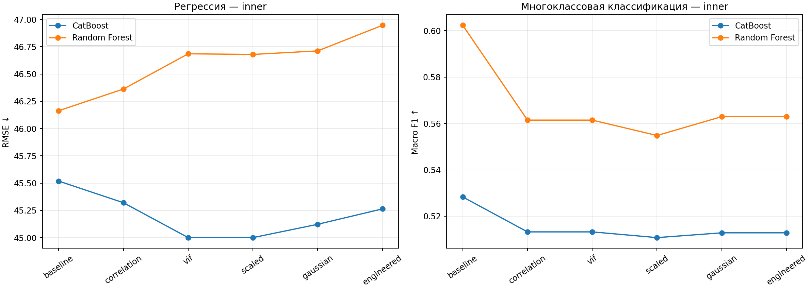
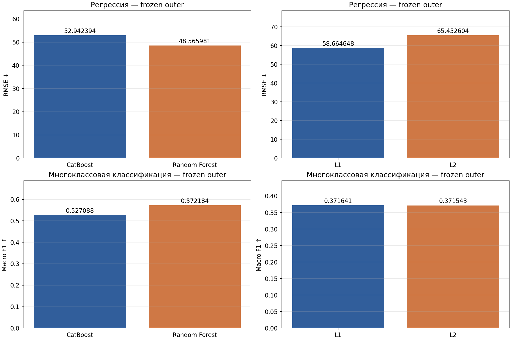
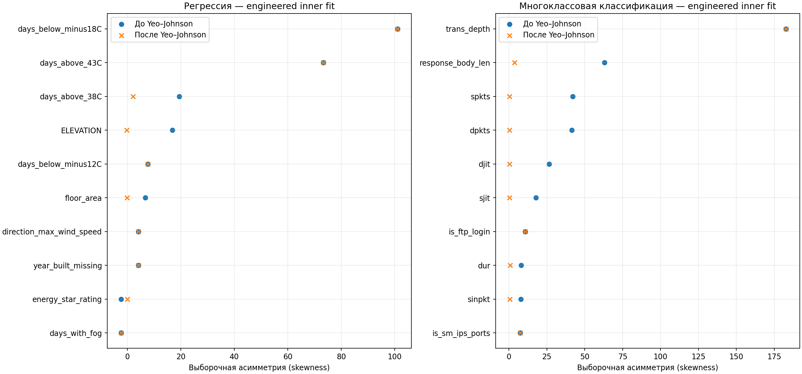

# Результаты экспериментов по предобработке и регуляризации

Дата: 2026-10-23; серия: `preprocessing-v1`. Значения ниже получены из завершённых runs; генератор не обучает модели и не изменяет историю экспериментов.

[Все оценки: comparison.csv](comparison.csv)

## Регрессия

**Замороженный выбор по inner:** `CatBoost / vif / l2_leaf_reg=1`, outer rmse=52.942394. **Лучший наблюдавшийся outer среди деревьев:** `CatBoost / baseline`, rmse=45.935836; это описательный минимум/максимум панели, его использование для выбора создало бы оптимизм outer.

У замороженного inner-победителя Δ outer к baseline того же семейства: 7.006558. Итоговый файл сохраняет заранее выбранный вариант; он не объявляется доказанно лучшим.

Разбиение: `temporal outer: years <5 -> 5; inner: <4 -> 4`.

| Часть | Объектов |
| --- | --- |
| inner_fit | 22054 |
| inner_valid | 12946 |
| outer_fit | 35000 |
| outer_valid | 18308 |

### Поэтапная предобработка — inner

Baseline: imputation + one-hot. Последовательность cumulative: correlation → VIF → StandardScaler → Yeo–Johnson → engineering. Engineering вычисляется в исходных единицах перед pruning и преобразованиями. Δ — текущая метрика минус предыдущая; для RMSE лучше отрицательное значение, для Macro F1 — положительное.

| Модель | Recipe | rmse | Δ к предыдущему | Признаков | Секунд |
| --- | --- | --- | --- | --- | --- |
| CatBoost | baseline | 45.518715 | — | 119 | 8.188000 |
| CatBoost | correlation | 45.320523 | -0.198192 | 105 | 7.140000 |
| CatBoost | vif | 45.000827 | -0.319697 | 79 | 5.390000 |
| CatBoost | scaled | 45.000847 | 0.000020 | 79 | 5.406000 |
| CatBoost | gaussian | 45.122835 | 0.121989 | 79 | 5.359000 |
| CatBoost | engineered | 45.263984 | 0.141149 | 82 | 5.843000 |
| Random Forest | baseline | 46.163929 | — | 119 | 22.844000 |
| Random Forest | correlation | 46.362483 | 0.198554 | 105 | 18.469000 |
| Random Forest | vif | 46.685331 | 0.322848 | 79 | 14.750000 |
| Random Forest | scaled | 46.679706 | -0.005625 | 79 | 14.140000 |
| Random Forest | gaussian | 46.711833 | 0.032127 | 79 | 15.906000 |
| Random Forest | engineered | 46.946364 | 0.234531 | 82 | 14.453000 |

### Замороженная панель — outer

Все конфигурации выбраны до outer. Сравнение cumulative recipe с baseline измеряет совокупный эффект pipeline; отдельный вклад шага показан только на inner.

| Конфигурация | rmse | Секунд | Сходимость | Артефакты |
| --- | --- | --- | --- | --- |
| CatBoost / baseline | 45.935836 | 12.656000 | да | [run](HYP-001-06-regression-outer-baseline-catboost/report.md) |
| CatBoost / engineered | 46.999742 | 10.391000 | да | [run](HYP-005-03-regression-outer-engineered-catboost/report.md) |
| CatBoost / vif | 54.628428 | 8.547000 | да | [run](HYP-002-03-regression-outer-vif-catboost/report.md) |
| Random Forest / baseline | 48.565981 | 42.141000 | да | [run](HYP-001-07-regression-outer-baseline-forest/report.md) |
| Random Forest / engineered | 46.877846 | 24.891000 | да | [run](HYP-005-04-regression-outer-engineered-forest/report.md) |
| CatBoost / vif / l2_leaf_reg=1 | 52.942394 | 4.938000 | да | [run](HYP-006-04-regression-outer-vif-catboost-1/report.md) |
| L1 / engineered / strength=1 | 58.664648 | 0.094000 | да | [run](HYP-007-07-regression-outer-engineered-l1-1/report.md) |
| L2 / engineered / strength=10 | 65.452604 | 0.282000 | да | [run](HYP-007-08-regression-outer-engineered-l2-10/report.md) |

Парные сравнения используют одни и те же сохранённые validation-объекты; метрики пересчитаны из прогнозов. Δ=A−B; это разность метрик, не тест значимости.

| A | B | rmse A | rmse B | Δ A−B |
| --- | --- | --- | --- | --- |
| CatBoost: inner winner + native L2 | Random Forest: inner winner | 52.942394 | 48.565981 | 4.376413 |
| L1: inner strength winner | L2: inner strength winner | 58.664648 | 65.452604 | -6.787956 |
| CatBoost: выбранный native L2 | CatBoost: тот же recipe, l2=3 | 52.942394 | 54.628428 | -1.686034 |

Выбранный CatBoost recipe: `vif`, l2_leaf_reg=1; RF recipe: `baseline`.

L1/L2 относятся к Lasso/Ridge в регрессии и multinomial LogisticRegression в классификации, а не к Random Forest. Native L2 CatBoost показан отдельно. Числа alpha у Lasso и Ridge имеют разные нормировки и не означают равную силу штрафа.

Подбор линейных штрафов на inner (сходимость не гарантирует хорошего качества):

| Модель | Сила штрафа / C | rmse | Сходимость |
| --- | --- | --- | --- |
| L1 | 0.01 | 611.145035 | да |
| L1 | 0.1 | 517.428404 | да |
| L1 | 1 | 54.197138 | да |
| L2 | 0.1 | 878.177037 | да |
| L2 | 1 | 884.672960 | да |
| L2 | 10 | 719.024794 | да |

Оба выбранных линейных outer fit завершились без ConvergenceWarning; вывод всё равно ограничен одним split и проверенной сеткой.

### Диагностика нестабильного линейного результата

Ridge inner RMSE=719.024794, outer RMSE=65.452604. В inner прогнозы достигают -29292.28. Для ноябрьской температуры сохранённый Yeo–Johnson λ=-2.975738 при входе -0.685185 °C даёт z≈-10613.6; это выход далеко за диапазон обучающей части.

234 строк ниже minimum температуры inner fit дают 99.56% SSE Ridge. State_4 отсутствует в inner fit; 232 его строки дают 99.56% SSE. На outer VIF уже удалил этот признак: при новом fit изменился состав предикторов. Это согласуется с нестабильной экстраполяцией при сдвиге данных, но не доказывает полную причинность одного признака; сохранённых коэффициентов линейной модели нет. Вычисление метрик и соответствие таргетов проверены отдельно, новых fit не проводилось.

[Подробная проверка](series-regression-preprocessing-v1/method-review.md), [численные доказательства](series-regression-preprocessing-v1/method-review-evidence.json), [крайние прогнозы](series-regression-preprocessing-v1/ridge-inner-tail.csv).

### Диагностика полного engineered recipe на inner fit

Удалены по Pearson/Spearman ≥0.95: `january_avg_temp_c`, `february_min_temp_c`, `march_avg_temp_c`, `april_avg_temp_c`, `august_max_temp_c`, `september_min_temp_c`, `september_avg_temp_c`, `november_max_temp_c`, `december_avg_temp_c`, `heating_degree_days_c`, `snowdepth_inches`, `days_below_minus7C`, `direction_peak_wind_speed`, `max_wind_speed`, `monthly_temp_mean`, `monthly_temp_spread`, `heating_cooling_total`, `floor_area_log1p`, `direction_peak_wind_speed_missing`, `max_wind_speed_missing`, `days_with_fog_missing`.

Удалены при итеративном VIF>10/вырожденности: `avg_temp_c` (vif_above_threshold), `february_avg_temp_c` (vif_above_threshold), `july_avg_temp_c` (vif_above_threshold), `november_min_temp_c` (vif_above_threshold), `february_max_temp_c` (vif_above_threshold), `cooling_degree_days_c` (vif_above_threshold), `june_avg_temp_c` (vif_above_threshold), `january_min_temp_c` (vif_above_threshold), `march_max_temp_c` (vif_above_threshold), `august_avg_temp_c` (vif_above_threshold), `may_min_temp_c` (vif_above_threshold), `snowfall_inches` (vif_above_threshold), `august_min_temp_c` (vif_above_threshold), `precipitation_inches` (vif_above_threshold), `december_min_temp_c` (vif_above_threshold), `days_below_minus1C` (vif_above_threshold), `march_min_temp_c` (vif_above_threshold), `april_max_temp_c` (vif_above_threshold), `october_avg_temp_c` (vif_above_threshold), `december_max_temp_c` (vif_above_threshold), `april_min_temp_c` (vif_above_threshold), `july_min_temp_c` (vif_above_threshold), `days_above_27C` (vif_above_threshold), `july_max_temp_c` (vif_above_threshold), `september_max_temp_c` (vif_above_threshold), `days_above_32C` (vif_above_threshold).

VIF относится только к числовым признакам после median imputation, до нелинейных преобразований и one-hot; его порог не гарантируется для итоговой матрицы.

Yeo–Johnson fit: `floor_area`, `energy_star_rating`, `ELEVATION`, `june_max_temp_c`, `november_avg_temp_c`, `days_above_38C`.

| Оставленный numeric | Skew до | Skew после |
| --- | --- | --- |
| days_below_minus18C | 101.080939 | 101.080939 |
| days_above_43C | 73.270360 | 73.270360 |
| days_above_38C | 19.447429 | 2.189293 |
| ELEVATION | 16.886113 | -0.247851 |
| days_below_minus12C | 7.659388 | 7.659388 |
| floor_area | 6.697072 | -0.096085 |
| direction_max_wind_speed | 4.198701 | 4.198701 |
| year_built_missing | 4.126919 | 4.126919 |
| energy_star_rating | -2.322553 | 0.072783 |
| days_with_fog | -2.308089 | -2.308089 |

### Итоговое обучение

На полном train переобучен inner-победитель деревьев: `CatBoost / vif / l2_leaf_reg=1`. Выбор не менялся по outer; скрытый test здесь не оценён.

- [submission.csv](HYP-005-05-regression-full-refit/submission.csv)
- [model.joblib](HYP-005-05-regression-full-refit/model.joblib)
- [preprocessed_data.npz](HYP-005-05-regression-full-refit/preprocessed_data.npz)
- [preprocessing_audit.json](HYP-005-05-regression-full-refit/preprocessing_audit.json)
- [metrics.json](HYP-005-05-regression-full-refit/metrics.json)

[Замороженный выбор](series-regression-preprocessing-v1/frozen_selection.json), [полный summary](series-regression-preprocessing-v1/summary.json), [окружение и hashes](series-regression-preprocessing-v1/environment.json).

## Многоклассовая классификация

**Замороженный выбор по inner:** `Random Forest / baseline`, outer macro_f1=0.572184. **Лучший наблюдавшийся outer среди деревьев:** `Random Forest / baseline`, macro_f1=0.572184; это описательный минимум/максимум панели, его использование для выбора создало бы оптимизм outer.

У замороженного inner-победителя Δ outer к baseline того же семейства: 0.000000. Итоговый файл сохраняет заранее выбранный вариант; он не объявляется доказанно лучшим.

Разбиение: `stratified group outer5/inner4 first folds; exact raw feature groups; seed42`.

| Часть | Объектов |
| --- | --- |
| inner_fit | 52762 |
| inner_valid | 17767 |
| outer_fit | 70529 |
| outer_valid | 17141 |

Использован StratifiedGroupKFold: первый fold из 5 для outer, первый fold из 4 внутри outer fit для inner, seed42. Группы — одинаковые исходные строки признаков без id и таргета; группа целиком находится по одну сторону split. Размеры и баланс могут отличаться от точных 80/20 и 75/25.

Самый редкий класс outer: **Worms**, support=19; его F1 чувствителен к нескольким ошибкам.

### Поэтапная предобработка — inner

Baseline: imputation + one-hot. Последовательность cumulative: correlation → VIF → StandardScaler → Yeo–Johnson → engineering. Engineering вычисляется в исходных единицах перед pruning и преобразованиями. Δ — текущая метрика минус предыдущая; для RMSE лучше отрицательное значение, для Macro F1 — положительное.

| Модель | Recipe | macro_f1 | Δ к предыдущему | Признаков | Секунд |
| --- | --- | --- | --- | --- | --- |
| CatBoost | baseline | 0.528302 | — | 193 | 193.250000 |
| CatBoost | correlation | 0.513234 | -0.015068 | 178 | 129.812000 |
| CatBoost | vif | 0.513234 | 0.000000 | 178 | 124.860000 |
| CatBoost | scaled | 0.510766 | -0.002468 | 178 | 128.360000 |
| CatBoost | gaussian | 0.512829 | 0.002063 | 178 | 111.219000 |
| CatBoost | engineered | 0.512829 | 0.000000 | 178 | 79.609000 |
| Random Forest | baseline | 0.602351 | — | 193 | 45.125000 |
| Random Forest | correlation | 0.561459 | -0.040892 | 178 | 35.532000 |
| Random Forest | vif | 0.561459 | 0.000000 | 178 | 32.688000 |
| Random Forest | scaled | 0.554821 | -0.006638 | 178 | 29.360000 |
| Random Forest | gaussian | 0.562953 | 0.008132 | 178 | 42.578000 |
| Random Forest | engineered | 0.562953 | 0.000000 | 178 | 49.453000 |

### Замороженная панель — outer

Все конфигурации выбраны до outer. Сравнение cumulative recipe с baseline измеряет совокупный эффект pipeline; отдельный вклад шага показан только на inner.

| Конфигурация | macro_f1 | Секунд | Сходимость | Артефакты |
| --- | --- | --- | --- | --- |
| CatBoost / baseline | 0.523953 | 222.234000 | да | [run](HYP-001-11-multiclass-outer-baseline-catboost/report.md) |
| CatBoost / engineered | 0.507527 | 153.406000 | да | [run](HYP-005-09-multiclass-outer-engineered-catboost/report.md) |
| Random Forest / baseline | 0.572184 | 95.016000 | да | [run](HYP-001-12-multiclass-outer-baseline-forest/report.md) |
| Random Forest / engineered | 0.559498 | 64.360000 | да | [run](HYP-005-10-multiclass-outer-engineered-forest/report.md) |
| CatBoost / baseline / l2_leaf_reg=1 | 0.527088 | 230.360000 | да | [run](HYP-006-08-multiclass-outer-baseline-catboost-1/report.md) |
| L1 / engineered / strength=1 | 0.371641 | 338.672000 | да | [run](HYP-007-15-multiclass-outer-engineered-l1-1/report.md) |
| L2 / engineered / strength=0.1 | 0.371543 | 239.218000 | да | [run](HYP-007-16-multiclass-outer-engineered-l2-0.1/report.md) |

Парные сравнения используют одни и те же сохранённые validation-объекты; метрики пересчитаны из прогнозов. Δ=A−B; это разность метрик, не тест значимости.

| A | B | macro_f1 A | macro_f1 B | Δ A−B |
| --- | --- | --- | --- | --- |
| CatBoost: inner winner + native L2 | Random Forest: inner winner | 0.527088 | 0.572184 | -0.045096 |
| L1: inner strength winner | L2: inner strength winner | 0.371641 | 0.371543 | 0.000099 |
| CatBoost: выбранный native L2 | CatBoost: тот же recipe, l2=3 | 0.527088 | 0.523953 | 0.003134 |

Выбранный CatBoost recipe: `baseline`, l2_leaf_reg=1; RF recipe: `baseline`.

L1/L2 относятся к Lasso/Ridge в регрессии и multinomial LogisticRegression в классификации, а не к Random Forest. Native L2 CatBoost показан отдельно. Числа alpha у Lasso и Ridge имеют разные нормировки и не означают равную силу штрафа.

Подбор линейных штрафов на inner (сходимость не гарантирует хорошего качества):

| Модель | Сила штрафа / C | macro_f1 | Сходимость |
| --- | --- | --- | --- |
| L1 | 0.01 | 0.376382 | да |
| L1 | 0.1 | 0.375598 | да |
| L1 | 1 | 0.377532 | да |
| L2 | 0.01 | 0.376221 | да |
| L2 | 0.1 | 0.377515 | да |
| L2 | 1 | 0.377503 | да |

Оба выбранных линейных outer fit завершились без ConvergenceWarning; вывод всё равно ограничен одним split и проверенной сеткой.

### F1 каждого класса — outer

| Класс | Support | CatBoost F1 | RF F1 | L1 F1 | L2 F1 |
| --- | --- | --- | --- | --- | --- |
| Worms | 19 | 0.173913 | 0.166667 | 0.000000 | 0.000000 |
| Shellcode | 118 | 0.538462 | 0.606061 | 0.000000 | 0.000000 |
| Backdoor | 158 | 0.127168 | 0.226804 | 0.000000 | 0.000000 |
| Analysis | 211 | 0.181818 | 0.223938 | 0.000000 | 0.000000 |
| Reconnaissance | 1017 | 0.799161 | 0.814169 | 0.481890 | 0.481637 |
| DoS | 1195 | 0.099323 | 0.279745 | 0.084953 | 0.084953 |
| Fuzzers | 1839 | 0.713640 | 0.743301 | 0.588452 | 0.587802 |
| Exploits | 3286 | 0.735241 | 0.748035 | 0.696632 | 0.696632 |
| Generic | 3733 | 0.986428 | 0.987284 | 0.980816 | 0.980816 |
| Normal | 5565 | 0.915726 | 0.925832 | 0.883672 | 0.883588 |

Полные precision/recall/F1 сохранены в `classification_report.txt` каждого run; порядок строк выше — от редких классов к частым.

### Диагностика полного engineered recipe на inner fit

Удалены по Pearson/Spearman ≥0.95: `sbytes`, `dbytes`, `sload`, `sloss`, `dloss`, `dinpkt`, `dwin`, `synack`, `ackdat`, `dmean`, `ct_src_dport_ltm`, `ct_dst_src_ltm`, `ct_ftp_cmd`, `ct_flw_http_mthd`, `ct_srv_dst`, `src_bytes_per_packet`, `dst_bytes_per_packet`, `dbytes_log1p`, `spkts_log1p`, `dpkts_log1p`.

Удалены при итеративном VIF>10/вырожденности: `sbytes_log1p` (vif_above_threshold).

VIF относится только к числовым признакам после median imputation, до нелинейных преобразований и one-hot; его порог не гарантируется для итоговой матрицы.

Yeo–Johnson fit: `dur`, `spkts`, `dpkts`, `rate`, `dload`, `sinpkt`, `sjit`, `djit`, `stcpb`, `dtcpb`, `tcprtt`, `smean`, `response_body_len`, `ct_srv_src`, `ct_dst_ltm`, `ct_dst_sport_ltm`, `ct_src_ltm`.

| Оставленный numeric | Skew до | Skew после |
| --- | --- | --- |
| trans_depth | 182.729636 | 182.729636 |
| response_body_len | 62.986223 | 3.584862 |
| spkts | 42.045138 | 0.314460 |
| dpkts | 41.482128 | 0.251317 |
| djit | 26.536529 | 0.428852 |
| sjit | 17.852869 | 0.286048 |
| is_ftp_login | 10.662184 | 10.662184 |
| dur | 8.092080 | 0.767999 |
| sinpkt | 7.717285 | 0.455221 |
| is_sm_ips_ports | 7.442152 | 7.442152 |

### Итоговое обучение

На полном train переобучен inner-победитель деревьев: `Random Forest / baseline`. Выбор не менялся по outer; скрытый test здесь не оценён.

- [submission.csv](HYP-005-12-multiclass-full-refit/submission.csv)
- [model.joblib](HYP-005-12-multiclass-full-refit/model.joblib)
- [preprocessed_data.npz](HYP-005-12-multiclass-full-refit/preprocessed_data.npz)
- [preprocessing_audit.json](HYP-005-12-multiclass-full-refit/preprocessing_audit.json)
- [metrics.json](HYP-005-12-multiclass-full-refit/metrics.json)

[Замороженный выбор](series-multiclass-preprocessing-v1/frozen_selection.json), [полный summary](series-multiclass-preprocessing-v1/summary.json), [окружение и hashes](series-multiclass-preprocessing-v1/environment.json).

## Дополнительная проверка сохранённого feature engineering — HYP-008

В основном cumulative recipe pruning может удалить новые признаки. Здесь включён только engineer=True: correlation, VIF, scaling и Yeo–Johnson выключены. Это разведочный анализ после просмотра основной диагностики и части regression outer; validation split использован повторно, независимого подтверждения нет. Замороженный основной выбор и его файлы не изменены; возможный дополнительный артефакт указан отдельно.

Технический сбой дополнительного wrapper (Регрессия): `KeyError('rmse')`. Это ошибка выполнения обвязки, а не отрицательный ML-результат гипотезы; ниже приведены завершённые оценки из итогового summary. [Исходный статус сбоя](series-regression-engineering-control-v1/engineering-control-status.json).

Происхождение продолжения: [continuation-environment.json](series-regression-engineering-control-v1/continuation-environment.json).

Регрессия, inner: сохранены 10 новых numeric: `monthly_temp_mean`, `monthly_temp_spread`, `heating_cooling_total`, `floor_area_log1p`, `year_built_missing`, `energy_star_rating_missing`, `direction_max_wind_speed_missing`, `direction_peak_wind_speed_missing`, `max_wind_speed_missing`, `days_with_fog_missing`.

Регрессия, outer: сохранены 10 новых numeric: `monthly_temp_mean`, `monthly_temp_spread`, `heating_cooling_total`, `floor_area_log1p`, `year_built_missing`, `energy_star_rating_missing`, `direction_max_wind_speed_missing`, `direction_peak_wind_speed_missing`, `max_wind_speed_missing`, `days_with_fog_missing`.

[Supplement summary — Регрессия](series-regression-engineering-control-v1/engineering-control-summary.json).

Дополнительный exploratory артефакт Регрессия: `CatBoost / engineering_only`. Его выбор зафиксирован по дополнительному inner перед дополнительной outer-оценкой; основной winner сохраняется.

- [Регрессия: дополнительный submission.csv](HYP-005-08-regression-full-refit/submission.csv)
- [Регрессия: дополнительный model.joblib](HYP-005-08-regression-full-refit/model.joblib)
- [Регрессия: дополнительный preprocessed_data.npz](HYP-005-08-regression-full-refit/preprocessed_data.npz)
- [Регрессия: дополнительный metrics.json](HYP-005-08-regression-full-refit/metrics.json)

Многоклассовая классификация, inner: сохранены 6 новых numeric: `src_bytes_per_packet`, `dst_bytes_per_packet`, `sbytes_log1p`, `dbytes_log1p`, `spkts_log1p`, `dpkts_log1p`.

Многоклассовая классификация, outer: сохранены 6 новых numeric: `src_bytes_per_packet`, `dst_bytes_per_packet`, `sbytes_log1p`, `dbytes_log1p`, `spkts_log1p`, `dpkts_log1p`.

[Supplement summary — Многоклассовая классификация](series-multiclass-engineering-control-v1/engineering-control-summary.json).

Дополнительный exploratory артефакт Многоклассовая классификация: `Random Forest / baseline`. Его выбор зафиксирован по дополнительному inner перед дополнительной outer-оценкой; основной winner сохраняется.

- [Многоклассовая классификация: дополнительный submission.csv](HYP-005-11-multiclass-full-refit/submission.csv)
- [Многоклассовая классификация: дополнительный model.joblib](HYP-005-11-multiclass-full-refit/model.joblib)
- [Многоклассовая классификация: дополнительный preprocessed_data.npz](HYP-005-11-multiclass-full-refit/preprocessed_data.npz)
- [Многоклассовая классификация: дополнительный metrics.json](HYP-005-11-multiclass-full-refit/metrics.json)

| Задача | Часть | Модель | Baseline | Engineering only | Δ к baseline | Новых numeric | Артефакты |
| --- | --- | --- | --- | --- | --- | --- | --- |
| Регрессия | inner | CatBoost | 45.518715 | 44.976675 | -0.542041 | 10 | [run](HYP-008-01-regression-inner-engineering_only-catboost/report.md) |
| Регрессия | inner | Random Forest | 46.163929 | 46.123522 | -0.040408 | 10 | [run](HYP-008-02-regression-inner-engineering_only-forest/report.md) |
| Регрессия | outer | CatBoost | 45.935836 | 45.204915 | -0.730921 | 10 | [run](HYP-008-03-regression-outer-engineering_only-catboost/report.md) |
| Регрессия | outer | Random Forest | 48.565981 | 46.708293 | -1.857687 | 10 | [run](HYP-008-04-regression-outer-engineering_only-forest/report.md) |
| Многоклассовая классификация | inner | CatBoost | 0.528302 | 0.526516 | -0.001786 | 6 | [run](HYP-008-05-multiclass-inner-engineering_only-catboost/report.md) |
| Многоклассовая классификация | inner | Random Forest | 0.602351 | 0.594620 | -0.007731 | 6 | [run](HYP-008-06-multiclass-inner-engineering_only-forest/report.md) |
| Многоклассовая классификация | outer | CatBoost | 0.523953 | 0.523929 | -0.000024 | 6 | [run](HYP-008-07-multiclass-outer-engineering_only-catboost/report.md) |
| Многоклассовая классификация | outer | Random Forest | 0.572184 | 0.577366 | 0.005182 | 6 | [run](HYP-008-08-multiclass-outer-engineering_only-forest/report.md) |

Для регрессии таблица показывает RMSE (меньше лучше), для классификации Macro F1 (больше лучше). Новые numeric включают индикаторы пропусков, если они появились. Улучшение в этой дополнительной проверке не изменяет основной заранее замороженный winner.

## Ограничения выводов

Каждый эффект относится к этим данным, одному validation split и фиксированному бюджету. Подбор на inner создаёт оптимизм inner-результатов; outer использован только для заранее замороженной панели. Разности метрик не доказывают универсального превосходства модели и не оценивают leaderboard или скрытый test.

Стандартное масштабирование почти не меняет деревья. Нормальность признаков и таргета не является их требованием; Yeo–Johnson не гарантирует нормального распределения. Таргет не преобразовывался. Приведённая асимметрия характеризует marginal distribution оставленных числовых признаков, а не совместную нормальность.

Точный групповой split классификации защищает от одинаковых строк по обе стороны разбиения, но не доказывает независимость всех сетевых наблюдений. Регрессия проверена переносом на следующий год; проверка не охватывает все возможные временные сдвиги.

## Документация методов

[CatBoost: l2_leaf_reg](https://catboost.ai/docs/en/references/training-parameters/common), [Random Forest: параметры и cost-complexity pruning](https://scikit-learn.org/stable/modules/generated/sklearn.ensemble.RandomForestRegressor.html), [StandardScaler и Yeo–Johnson](https://sklearn.org/stable/modules/preprocessing.html), [масштабирование и деревья](https://scikit-learn.org/stable/auto_examples/preprocessing/plot_scaling_importance.html).
